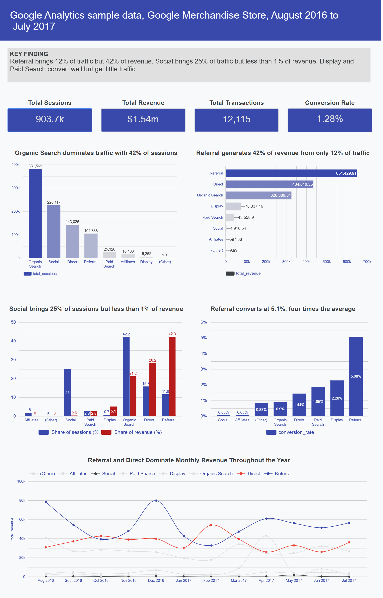

# Google Merchandise Store: Marketing Channel Performance Analysis

A SQL and dashboard project analysing which marketing channels drive revenue, which drive traffic only, and where budget should be reallocated for maximum return.

**[View the live dashboard](https://datastudio.google.com/reporting/76ac1c2f-e423-42cb-96f3-16e82535f60c)**

> Written in SQL with AI support as a learning aid, while I build my own SQL fluency.

---

## Business context

The marketing director at the Google Merchandise Store is heading into a quarterly budget review and needs to justify where spend is going. They do not know which channels are genuinely driving revenue versus which are simply driving traffic. This analysis was produced to inform that budget allocation decision.

## Business problem statement

The Google Merchandise Store is spending across multiple marketing channels. This analysis identifies which channels drive revenue, which drive traffic only, and recommends where budget should be focused for maximum return.

## Dataset

**Source:** Google Analytics Sample dataset (BigQuery public data)
**Table:** `bigquery-public-data.google_analytics_sample.ga_sessions_*`
**Date range:** August 2016 – August 2017 (August 2017 incomplete)
**Volume:** ~900,000 sessions across 8 marketing channels

## Note on project context

This project uses a public Google Analytics sample dataset. The business context, problem statement, and stakeholder framing were created by me to 
simulate a real-world scenario, in order to demonstrate an end-to-end analytical workflow from business question through to recommendation.

## Hypothesis

Based on prior experience in B2B marketing, referral channels tend to convert well for lower-authority brands due to third-party trust signals. However, given the Google Merchandise Store's high brand recognition, organic search was expected to be the top-performing channel by both revenue and conversion rate, as users arrive with high purchase intent. Paid search was expected to underperform relative to its traffic volume. Direct traffic was expected to perform strongly as a secondary channel, driven by returning customers with existing brand familiarity.

## Business questions

| # | Question | What it tells us |
|---|---|---|
| Q1 | Which channels drive the most sessions? | Volume - where traffic comes from |
| Q2 | Which channels drive the most revenue? | Value - where money comes from |
| Q3 | Which channels have the highest conversion rate? | Efficiency - which channels close sales |
| Q4 | Which channels drive high traffic but low or no revenue? | Waste - where budget may be misallocated |
| Q5 | How has channel performance trended over the year? | Trend - is anything growing or declining |

## Process

1. Explored the dataset structure and identified data quality considerations (see below)
2. Wrote five SQL queries in BigQuery, one per business question, plus three more for the dashboard and for checks (see the [queries](./queries) folder)
3. Built an interactive Looker Studio dashboard connected directly to BigQuery
4. Compared findings against the original hypothesis
5. Documented findings and recommendations in [insights.md](./insights.md)

## Data cleaning notes

- **Revenue format:** `totals.transactionRevenue` is stored in micros and divided by 1,000,000 throughout to convert to dollars
- **Null revenue:** Sessions without a transaction return null revenue; handled using `IFNULL` where totals are calculated
- **Incomplete month:** August 2017 contains partial data only, as the dataset ends mid-month, and is excluded from trend conclusions
- **Unclassified traffic:** The `(Other)` channel grouping is excluded from recommendations due to negligible volume

## Key findings summary

| Channel | Traffic Rank | Revenue Rank | Conversion Rank | Key Insight |
|---|---|---|---|---|
| Organic Search | 1st | 3rd | 5th | High volume, moderate value - efficient but not the top converter |
| Social | 2nd | 6th | 7th | High traffic, near zero commercial return - wrong KPIs applied |
| Direct | 3rd | 2nd | 4th | Strong revenue, conversion suppressed by staff and bookmark traffic |
| Referral | 4th | 1st | 1st | Lowest traffic of top channels, highest value - most efficient channel |
| Affiliates | 6th | 7th | 7th | Low traffic and low value - minimal impact on business |
| Paid Search | 5th | 5th | 3rd | Small volume but strong conversion - underinvested for its efficiency |
| Display | 7th | 4th | 2nd | Tiny traffic, strong conversion - significant untapped potential |
| (Other) | 8th | 8th | 6th | Unclassified traffic - excluded from recommendations |

## Hypothesis vs Reality

The hypothesis predicted Organic Search would lead on both revenue and conversion rate due to the brand's high authority. The data shows Referral led on both, ranking 1st for revenue and 1st for conversion rate, while Organic Search ranked 3rd and 5th respectively. This suggests that even for high-authority brands, third-party trust signals from referral sources remain a stronger driver of purchase intent than direct brand search. The prediction for Paid Search was wrong: it has a small share of traffic, but it ranks 3rd for conversion rate and earns more revenue than its traffic share would suggest. Direct performed strongly as predicted, ranking 2nd for revenue.

## Detailed findings & recommendations

See [insights.md](./insights.md) for the full write-up of all seven findings, including specific recommendations for budget reallocation, channel measurement, and SEO strategy.

## Limitations

- **No cost data:** the dataset has no ad spend, so return on investment and ROAS cannot be calculated. Budget recommendations are therefore framed as tests to run, not as final decisions.
- **Channel attribution:** `channelGrouping` gives each session one channel, so a customer journey across several channels is not visible.
- **Sample data:** this is a public sample from one online store between 2016 and 2017, so the results may not apply to other businesses or to current behaviour.
- **Referral traffic:** the Referral channel may include visits from Google's own internal sites. [Query 6](./queries/06_top_referral_sources.sql) checks which sources drive Referral revenue.

## Skills demonstrated

- SQL in BigQuery: aggregation, `COUNTIF`, window functions (`OVER()`), date parsing and handling of null values
- Data cleaning: currency conversion, null values, incomplete months and unclassified traffic
- Dashboard design in Looker Studio, connected directly to BigQuery
- Turning results into business recommendations for a non-technical audience

## Tools used

BigQuery (SQL), Looker Studio (dashboard and visualisation)

